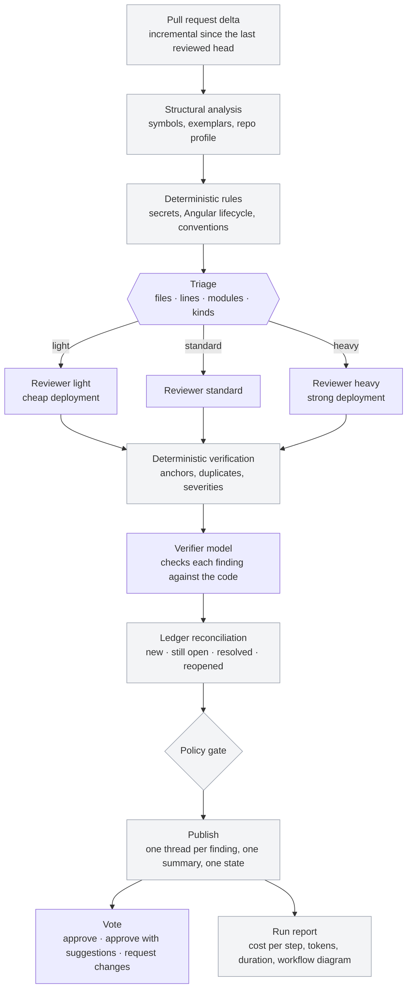

# air-review

AI code review that behaves like a careful colleague on a pull request: it
measures each change, routes it to a cheap or a strong reviewer agent, verifies
every finding against the code before publishing, remembers what it already
reviewed, and votes on the pull request. Models run on **Microsoft Foundry**
(or any OpenAI-compatible endpoint); the first integration target is
**Azure DevOps**.

> **New here?** Follow the 30-minute guide: [docs/getting-started.md](docs/getting-started.md)
> (français : [docs/fr/demarrage.md](docs/fr/demarrage.md)).

```text
diff → structural analysis → triage (which agent?) → reviewer (light | standard | heavy)
     → verifier → ledger (what changed since last time?) → PR comments + vote + cost report
```

## Architecture



Grey boxes are deterministic software; only triage, the reviewer and the
verifier are model calls, and each can be a different model (or Foundry
agent) chosen by configuration. Details: [docs/architecture.md](docs/architecture.md).

**Why it is different.** The model is not the product; the evidence given to
it is. Deterministic code handles what software can decide exactly (diffs,
symbols, subscriptions, secrets, the gate, the ledger, the cache) and the
model is only paid for reasoning. The reviewer sees how _your_ repository
already does the same thing (existing files of the same kind, the exported
API of imported modules, a repository profile), findings keep a stable
identity across pushes, and every run says which agent reviewed, why, and
what it cost.

## Installation

```bash
# Node.js >= 22.12
git clone https://github.com/paul-daniel/air-review-poc.git
cd air-review-poc
npm install
npm run build
npm link            # provides the `air-review` command
```

## Quickstart

```bash
cd your-repo
air-review init --provider azure-foundry --base-url https://my-res.services.ai.azure.com   # annotated air-review.yaml
air-review doctor                            # config, credential, endpoint, deployments, git, SCM
air-review inspect --base origin/main        # what the tool sees, no model call
air-review dry-run --base origin/main        # full review, nothing published
air-review review --publish                  # publish threads and vote (in a pipeline)
```

No credentials at hand? The offline provider runs the whole pipeline for free
and deterministically (deterministic rules still fire; the model steps return
nothing unless the diff carries `air-review:expect` test markers):

```bash
AIR_REVIEW_PROVIDER=mock air-review dry-run --base origin/main
```

Every run writes `.air-review/reports/<run>.md` with the routing decision,
the cost of each step and the workflow actually executed.

## Models on Microsoft Foundry

Two paths, both built on Microsoft's official SDKs and configured without
touching code. Any model deployed in Foundry works: GPT, DeepSeek, Llama,
Grok, Mistral and the model router through the OpenAI door (`openai`
package), **Claude** through the Anthropic door (`@anthropic-ai/foundry-sdk`),
prompt agents through `@azure/ai-projects`.

| `provider`            | What a role model is                                    | Endpoint                                                            |
| --------------------- | ------------------------------------------------------- | ------------------------------------------------------------------- |
| `azure-foundry`       | a **deployment name** (Claude ones start with `claude`) | `https://<resource>.services.ai.azure.com` (or `.openai.azure.com`) |
| `azure-foundry-agent` | a **prompt agent name** (Agent Service)                 | `https://<resource>.services.ai.azure.com/api/projects/<project>`   |

```yaml
provider: azure-foundry
models:
  roles: { triage: gpt-5-mini, reviewer: gpt-5, verifier: gpt-5-mini }
  tiers:
    light: { reviewer: claude-haiku-4-5 } # one translation file, a small helper
    heavy: { reviewer: claude-sonnet-4-5 } # large, cross-module pull requests
```

Credential: an API key, a provided token, or nothing at all (keyless
Microsoft Entra ID: `az login` on a laptop, the service connection in a
pipeline). `air-review doctor` says which one is in use.

Environment variables (`AIR_REVIEW_MODEL_REVIEWER`, `AIR_REVIEW_MODEL_REVIEWER_LIGHT`,
`AIR_REVIEW_MODEL_REVIEWER_HEAVY`, `AIR_REVIEW_ACCESS_TOKEN`, …) override the file, so a
pipeline variable group is enough. Full guide, commented example and start-up
procedure: [docs/foundry.md](docs/foundry.md).

## Azure DevOps

In a pull-request validation build the adapter is auto-detected. It keeps its
memory in the pull request itself (one state thread, one summary thread, one
thread per finding, never duplicated), reviews only what changed since the
last push, continues an existing thread when a fix is only partial, and exits
`10` so a build validation policy blocks the merge while blocking findings
remain. The review step votes **Waiting for author** (-5) when something
blocks; the approving vote (**Approved** 10, **Approved with suggestions** 5)
is cast by a separate `air-review approve` step that the pipeline runs once
the review, the build and the tests have all succeeded. The tool never
completes the pull request.

Ready-to-use pipeline and permissions: [docs/azure-devops.md](docs/azure-devops.md)
and [examples/azure-pipelines.yml](examples/azure-pipelines.yml).

## Reading the cost reports

The summary comment, the terminal and `.air-review/reports/<run>.md` all show
the same table: one row per step with status, agent/model, duration, input,
cached and output tokens and estimated cost, plus a Mermaid diagram of the
path really taken (skipped and cached steps greyed, unused reviewer tiers
shown as not selected). Prices come from `telemetry.pricing` (USD per million
tokens per deployment). Guide: [docs/observability.md](docs/observability.md).

## Commands

| Command                                                         | What it does                                                              |
| --------------------------------------------------------------- | ------------------------------------------------------------------------- |
| `air-review init`                                               | write a provider-ready, commented config                                  |
| `air-review doctor`                                             | check config, credential, endpoint, deployments, git and SCM              |
| `air-review example`                                            | copy-paste snippets (providers, CI, config, local)                        |
| `air-review inspect`                                            | what the tool sees: delta, structural facts, context plan                 |
| `air-review dry-run`                                            | full review, nothing published                                            |
| `air-review review [--publish] [--tier light\|standard\|heavy]` | review, publish, request changes when blocked                             |
| `air-review approve`                                            | cast the approving vote from the review in the PR (after build and tests) |
| `air-review explain [id]`                                       | stored findings, or one finding with its evidence                         |
| `air-review models`                                             | what the endpoint offers and which role uses it                           |
| `air-review telemetry`                                          | recent runs: tier, tokens, cost, duration, verdict                        |
| `air-review cache stats` / `prune`                              | inspect or clean the local result cache                                   |
| `air-review config get` / `set` / `unset` / `list`              | read or edit the config                                                   |

Exit codes: `0` gate passed · `10` gate failed · `20` config · `30` model/provider · `40` SCM · `50` internal.
Reference: [docs/commands.md](docs/commands.md).

## Documentation

| Document                                           | Contents                                                              |
| -------------------------------------------------- | --------------------------------------------------------------------- |
| [docs/architecture.md](docs/architecture.md)       | pipeline, roles, routing, finding lifecycle, memory model             |
| [docs/foundry.md](docs/foundry.md)                 | Microsoft Foundry: deployments, prompt agents, interchangeable models |
| [docs/azure-devops.md](docs/azure-devops.md)       | Azure Pipelines / Azure Repos: pipeline, permissions, vote, status    |
| [docs/review-format.md](docs/review-format.md)     | how the main AI reviewers format feedback, and what we chose          |
| [docs/observability.md](docs/observability.md)     | run reports, cost per step, workflow diagram, telemetry               |
| [docs/configuration.md](docs/configuration.md)     | every option with its default                                         |
| [docs/providers.md](docs/providers.md)             | vendor presets and endpoint recipes                                   |
| [docs/commands.md](docs/commands.md)               | every command with examples                                           |
| [docs/github-ci.md](docs/github-ci.md)             | GitHub Actions setup                                                  |
| [docs/security.md](docs/security.md)               | prompt-injection boundary, redaction, tokens                          |
| [docs/troubleshooting.md](docs/troubleshooting.md) | exit codes and common errors                                          |
| [RAPPORT.md](RAPPORT.md)                           | what was done, decisions taken, what remains (French)                 |

Test bed with ready-made pull-request scenarios (translation-only, small
classification helper, large multi-module feature, docs-only re-push, clean
refactor, planted defects):
[paul-daniel/air-review-test-repo](https://github.com/paul-daniel/air-review-test-repo).

## Development

```bash
npm install
npm run build
npm test            # unit tests (routing, cache, deduplication, adapters, rendering)
npm run check       # typecheck + lint + format + tests
npm run schema      # regenerate schema/air-review.schema.json
```

## License

MIT
