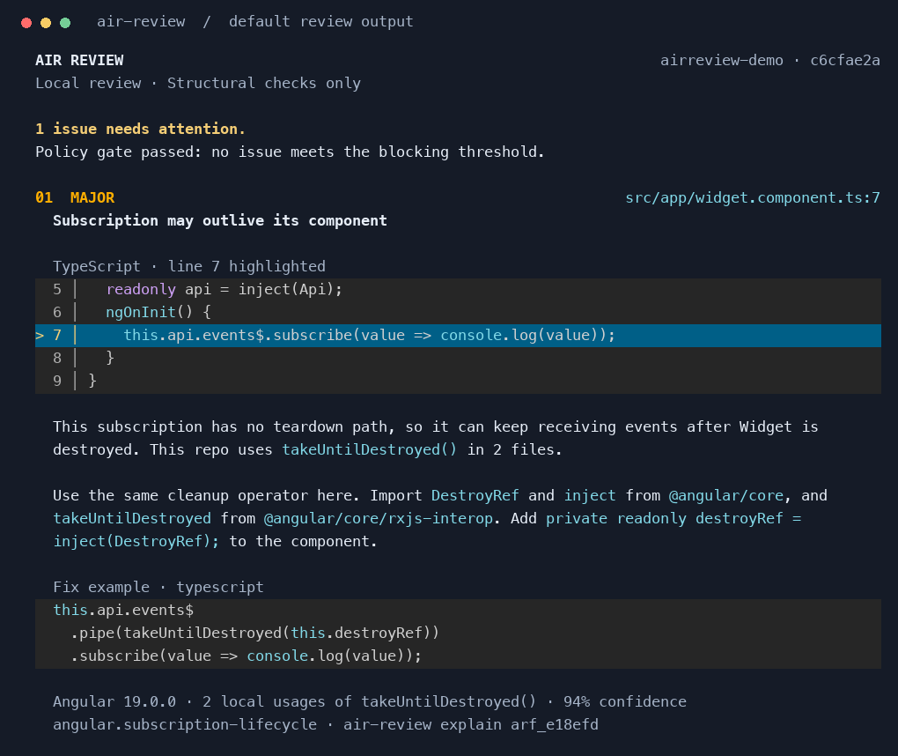

# air-review

Contextual AI code review as a CLI. Instead of dumping a diff into a model,
air-review builds a structural understanding of the change, gathers only the
evidence it needs, verifies findings before publishing, and remembers what it
already reviewed so follow-up pushes are incremental.

It runs on **GitHub** and **Azure DevOps (Azure Repos)** and any **OpenAI-compatible API** (OpenAI, Azure OpenAI,
Microsoft Foundry, Amazon Bedrock, Google, Anthropic, Mistral, Groq,
OpenRouter, internal gateways...), with an **Angular** context pack and one
model per agent role. Reviews are HTTP calls: no model downloads, no GPU, no
local runtime in the pipeline.

```text
diff → structural analysis → context plan (exemplars, imports, repo profile) → review → verification against code → incremental publish
```

## First local test

Run `npm run demo` to create a Git corpus with known defects, safe examples,
fixes and a regression. Follow [the Foundry first-run guide (French)](docs/first-local-test.fr.md).
Run `npm run test:api` for a free end-to-end test with a simulated Foundry API.

## Quickstart

```bash
# Node.js >= 22.12
# install from this repository
npm install && npm run build && npm link

cd your-angular-repo
export OPENAI_API_KEY=sk-...
air-review init                              # writes an annotated air-review.yaml
air-review doctor                            # config, key, endpoint, git, SCM
air-review dry-run --base origin/main        # full review, nothing published
air-review review --publish                  # publish findings
```

Not sure where to start? `air-review example` prints copy-paste snippets, and
every command documents its own examples: `air-review review --help`.

## Why it is different

The model is not the product; the evidence given to it is. Deterministic rules
handle what software can decide exactly (diffs, symbols, subscriptions,
conventions, secrets, the policy gate), and the model is only paid for
reasoning.

**Contextual** means the reviewer sees how _your_ repository already does the
same thing. Before the model call, the planner finds existing files of the same
kind as each changed file (a new component gets the two or three closest
components, a translation edit gets its sibling language file), reads the
exported API of the modules the change imports, and builds a one-paragraph
profile of the repository (languages, frameworks, test tools, translation
folders). When a change has no precedent in the repository, the model is told
so and asked for widely accepted practice instead of inventing a "convention".
`air-review inspect` shows exactly what will be sent, and why, before you pay
for a single token.

Findings separate severity from confidence and say where a fix belongs:

Colors are on by default. Findings show syntax-highlighted source, language
labels, affected lines and actionable fix examples. Concise review prose is
followed by compact evidence and confidence metadata. Interactive terminals
include a progress spinner and a brief report reveal. Use `--no-animation`
to disable motion, `--plain` for unstyled logs, or `--json` for automation.



Rule origins (`PROJECT_CONFIG`, `FRAMEWORK`, `REPO_CONVENTION`, `HEURISTIC`)
and the finding lifecycle are explained in [docs/architecture.md](docs/architecture.md).

## Commands

| Command                                                | What it does                                          |
| ------------------------------------------------------ | ----------------------------------------------------- |
| `air-review init`                                      | write a provider-ready config                         |
| `air-review doctor`                                    | check config, key, endpoint, models, git and SCM      |
| `air-review example`                                   | copy-paste snippets (providers, CI, config, local)    |
| `air-review inspect`                                   | what the tool sees — structural facts, no model calls |
| `air-review dry-run`                                   | full review, nothing published                        |
| `air-review review`                                    | review and optionally `--publish`                     |
| `air-review explain`                                   | list stored findings, or show one with its evidence   |
| `air-review models`                                    | what the endpoint offers, and which role uses it      |
| `air-review telemetry`                                 | recent runs with tokens, cost estimate and duration   |
| `air-review cache` / `stats` / `prune`                 | inspect or clean the local cache                      |
| `air-review config` / `get` / `set` / `unset` / `list` | read or edit config                                   |
| `air-review help [command]`                            | the full reference for any command                    |

Full details and examples: [docs/commands.md](docs/commands.md).

## In a pipeline

```yaml
# air-review.yaml (committed)
provider: azure-openai
models:
  roles:
    reviewer: my-reviewer-deployment
```

```yaml
# workflow step
- name: Air Review
  env:
    GITHUB_TOKEN: ${{ github.token }} # automatic on GitHub Actions
    AIR_REVIEW_API_KEY: ${{ secrets.AIR_REVIEW_API_KEY }}
  run: air-review review --publish
```

Everything can come from the repository settings, so the same config works on
any platform:

| Variable                                 | GitHub Actions | Azure DevOps | Value                                                |
| ---------------------------------------- | -------------- | ------------ | ---------------------------------------------------- |
| `AIR_REVIEW_PROVIDER`                    | variable       | variable     | preset id (`azure-openai`, `bedrock`, `google`, ...) |
| `AIR_REVIEW_BASE_URL`                    | variable       | variable     | endpoint URL                                         |
| `AIR_REVIEW_API_KEY`                     | **secret**     | **secret**   | provider API key                                     |
| `AIR_REVIEW_MODEL_REVIEWER`              | variable       | variable     | reviewer model / deployment name                     |
| `AIR_REVIEW_MODEL_PLANNER` / `_VERIFIER` | variable       | variable     | the two cheaper roles                                |

Exit code `10` fails the check when the gate finds blocking findings, so the
review behaves like build and test. Setup details:
[docs/github-ci.md](docs/github-ci.md) and [docs/azure-devops.md](docs/azure-devops.md).

| Platform                   | `--ci`         | Detected from                                   | Memory                                       |
| -------------------------- | -------------- | ----------------------------------------------- | -------------------------------------------- |
| GitHub                     | `github`       | `pull_request` event payload                    | PR issue comments + review comments          |
| Azure DevOps (Azure Repos) | `azure-devops` | `TF_BUILD` + `SYSTEM_PULLREQUEST_PULLREQUESTID` | PR threads (state, summary, one per finding) |
| any git checkout           | `local`        | fallback                                        | `.air-review/`                               |

## Telemetry

Every run reports per-role usage — tokens, model calls, cache hits, duration,
and an estimated cost when `telemetry.pricing` is configured:

```text
Usage & cost
Estimated cost (USD)  ~$0.0042 · 8.3 s · 2 API calls
Input   3,100 tokens · 1,000 from provider cache
Output  1,000 tokens · 200 reasoning
Cache is included in input; reasoning is included in output.
```

Cached input and reasoning token subsets are shown when reported by the API.
Configure `cachedInput` alongside `input` and `output` rates per deployment,
in USD per million tokens, or supply `AIR_REVIEW_PRICING` as JSON.
Local reviews always write `.air-review/summary.md` and `.air-review/context.md`.

The same record is appended to `.air-review/telemetry.jsonl` (local only,
nothing is sent anywhere) and can be uploaded as a CI artifact.
`air-review telemetry` shows recent runs.

## Configuration

```yaml
version: 1
provider: openai # see: air-review example providers
endpoint:
  baseUrl: https://api.openai.com/v1
  apiKeyEnv: OPENAI_API_KEY
models:
  roles:
    planner: gpt-4o-mini # context planning
    reviewer: gpt-4.1 # strong reasoning pass
    verifier: gpt-4o-mini # filters and calibrates before publishing
platform:
  provider: github
  publish: false
```

YAML, TOML and JSON are all read; environment variables override the file.
Every option, its default and its examples: [docs/configuration.md](docs/configuration.md).

## Documentation

| Document                                           | Contents                                                           |
| -------------------------------------------------- | ------------------------------------------------------------------ |
| [docs/commands.md](docs/commands.md)               | every command with examples and options                            |
| [docs/configuration.md](docs/configuration.md)     | complete option reference                                          |
| [docs/providers.md](docs/providers.md)             | vendor presets and endpoint recipes                                |
| [docs/github-ci.md](docs/github-ci.md)             | GitHub Actions setup                                               |
| [docs/azure-devops.md](docs/azure-devops.md)       | Azure Pipelines / Azure Repos setup, threads as memory             |
| [docs/live-check.md](docs/live-check.md)           | keyless first real run on Microsoft Foundry and an Azure DevOps PR |
| [docs/WORK-SETUP.md](docs/WORK-SETUP.md) | plain step-by-step: Foundry + Azure DevOps pipeline at work, no laptop involved |
| [docs/ASSESSMENT.md](docs/ASSESSMENT.md)           | product and engineering assessment, decisions, roadmap             |
| [docs/architecture.md](docs/architecture.md)       | pipeline, roles, finding lifecycle                                 |
| [docs/security.md](docs/security.md)               | prompt-injection boundary, redaction, tokens                       |
| [docs/troubleshooting.md](docs/troubleshooting.md) | exit codes and common errors                                       |

## Development

```bash
npm install
npm run build
npm test            # unit tests
npm run test:e2e    # full CLI scenario against a local fake model endpoint
npm run schema      # regenerate schema/air-review.schema.json
```

## Roadmap

Deferred by design: a Bitbucket adapter, per-role provider
mixing, more framework packs, semantic-search fallback, and a real-model quality
benchmark. The synthetic local corpus tests integration, not model accuracy.

## License

MIT
