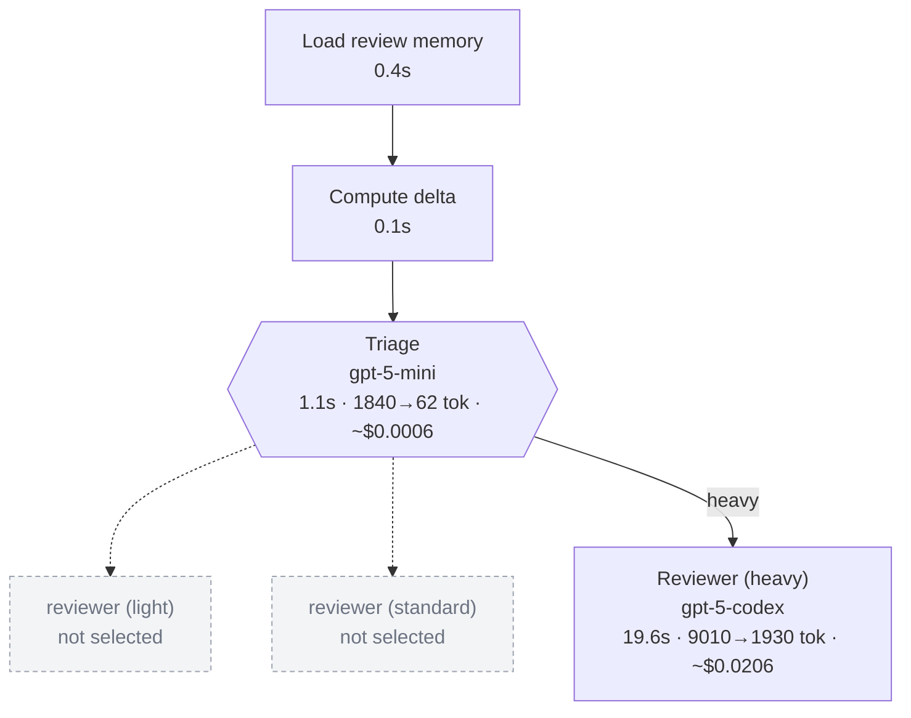

# Observability: cost per step, tokens, duration, agent, and the workflow actually run

Every review produces the same facts in four places: the terminal report,
the `--json` output, the summary comment on the pull request and a per-run
report on disk. Nothing is sent anywhere.

## The run report

`observability.reportDir` (default `.air-review/reports`) receives two files
per run, named after the run id shown in the summary:

- `<run>.md` — human report: header (repository, head, verdict, gate),
  **Routing** (tier, reviewer and verifier models, decision method, signals,
  reasons), **Cost and duration per step**, totals, the findings table and
  the **workflow diagram**;
- `<run>.json` — the same data (`summary`, `findings`, `configuredModels`)
  for dashboards or a pipeline artifact.

The step table:

| Step                               | Status | Agent · model            |   Duration |      Input | Cached |    Output |   Est. cost |
| ---------------------------------- | ------ | ------------------------ | ---------: | ---------: | -----: | --------: | ----------: |
| Load review memory                 | ✓      | deterministic            |      0.4 s |          – |      – |         – |           – |
| Compute delta                      | ✓      | deterministic            |      0.1 s |          – |      – |         – |           – |
| Structural analysis & context plan | ✓      | deterministic            |      0.3 s |          – |      – |         – |           – |
| Deterministic rules                | ✓      | deterministic            |      0.2 s |          – |      – |         – |           – |
| Triage                             | ✓      | triage · `gpt-5-mini`    |      1.1 s |      1,840 |      0 |        62 |    ~$0.0006 |
| Reviewer (heavy)                   | ✓      | reviewer · `gpt-5-codex` |     19.6 s |      9,010 |  8,064 |     1,930 |    ~$0.0206 |
| Deterministic verification         | ✓      | deterministic            |      0.0 s |          – |      – |         – |           – |
| Verifier                           | ✓      | verifier · `gpt-5-mini`  |      2.4 s |      2,310 |      0 |       240 |    ~$0.0011 |
| Reconcile with previous findings   | ✓      | deterministic            |      0.0 s |          – |      – |         – |           – |
| Policy gate                        | ✓      | deterministic            |      0.0 s |          – |      – |         – |           – |
| Publish to the pull request        | ✓      | deterministic            |      1.2 s |          – |      – |         – |           – |
| Verdict: request-changes           | ✓      | deterministic            |      0.5 s |          – |      – |         – |           – |
| **Total**                          |        | 3 model calls            | **25.8 s** | **13,160** |  8,064 | **2,232** | **~$0.022** |

Statuses: `✓` done, `⟳ cache` served from the local result cache (no request
sent), `– skipped` (not needed: already reviewed head, docs-only push,
`--deterministic-only`, no candidate to verify), `✗ failed`.

Reading it:

- **Agent · model** is which role ran and which deployment or agent it used
  on this run. The reviewer row names the tier in its label.
- **Input / Cached / Output** are the provider's token counts. Cached is a
  subset of input (billed at the cached rate); reasoning tokens, when
  reported, are a subset of output and shown in the totals line.
- **Est. cost** multiplies tokens by `telemetry.pricing`. A row shows `n/a`
  when its model has no price; the total is then unavailable rather than
  wrong.

## Pricing table

```yaml
telemetry:
  pricing: # USD per 1M tokens, keyed by deployment (or agent) name
    gpt-5: { input: 1.25, cachedInput: 0.125, output: 10 }
    gpt-5-mini: { input: 0.25, cachedInput: 0.025, output: 2 }
```

`AIR_REVIEW_PRICING='{"gpt-5":{"input":1.25,"cachedInput":0.125,"output":10}}'`
overrides the file. Keys must match the exact names used in `models.*`
(with Foundry's model router, the names of the underlying models it reports).
Prices are an estimate, not the invoice: compare them with the provider's
cost analysis page once, then trust the trend.

## The workflow diagram

The Mermaid flowchart is generated from the trace, not from a template. Each
node is a step that happened (or was skipped), with its model, duration,
token flow and cost. Conventions:

- solid nodes ran; dashed grey nodes were **skipped**; cyan nodes were
  served from the **cache**; red nodes **failed**;
- the triage hexagon's solid edge is labelled with the chosen tier; the two
  other tiers appear as dashed "not selected" branches;
- GitHub renders the block; Azure DevOps shows the source (paste it into
  https://mermaid.live).



Use it to tune the workflow:

- a heavy tier chosen for a change you consider small → raise
  `routing.heavy.minFiles/minLines/minModules`, or lower the light limits;
- the triage model consulted on every run → the middle band is too wide;
  switch to `routing.mode: deterministic` or adjust the thresholds;
- the reviewer row often `⟳ cache` → runs are being repeated on the same
  input (re-queued pipelines); the cache saved the cost;
- a verifier that drops most findings → the reviewer deployment is too
  noisy for this repository; try a stronger standard tier;
- a reviewer skipped with "nothing new to review" → a docs-only or
  binary-only push, as configured in `review.modelSkipKinds`.

## The summary comment

The pull-request summary carries the headline (verdict, head, open/resolved,
tier, cost, duration), the routing block, the findings table, "Since the
last review", and two collapsed sections with the step table and the
diagram (`observability.publishInSummary: false` removes them). See
[review-format.md](review-format.md).

## Telemetry log

`telemetry.log` (default `.air-review/telemetry.jsonl`) receives one JSON
line per run: timestamp, repository, pull request, from/head SHAs, skipped,
gate, verdict, routing (`tier`, `reviewerModel`, `method`), finding counts,
usage by role, estimated cost, the compact per-step trace (`steps[]` with
id, status, duration, model, tokens, cost) and the configured models.
`air-review telemetry --last 20` prints recent runs; `--json` returns them.
Upload the file or the reports directory as a pipeline artifact to keep a
history per branch.

## Metrics worth tracking over time

| Metric                                          | Where                                          | Why                             |
| ----------------------------------------------- | ---------------------------------------------- | ------------------------------- |
| cost / pull request and cost / tier             | telemetry `estimatedCostUsd`, `routing.tier`   | is routing saving money?        |
| share of runs with `reviewer` skipped or cached | `steps[]`                                      | incremental and cache behaviour |
| findings dropped by the verifier                | summary notes                                  | reviewer precision              |
| resolved vs reopened events                     | summary "Since the last review", state history | finding lifecycle health        |
| duration p50 / p95                              | `durationMs`                                   | pipeline latency budget         |
